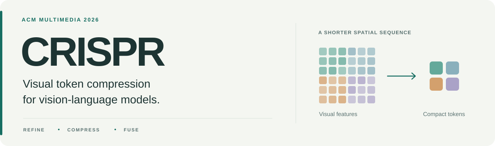
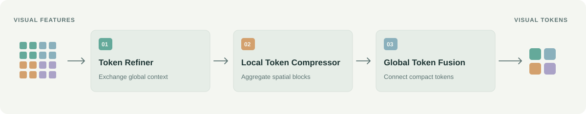
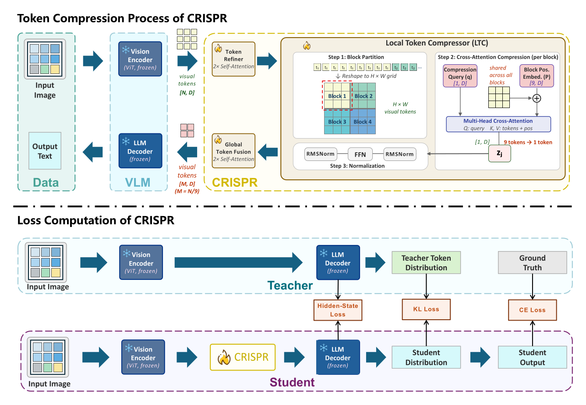
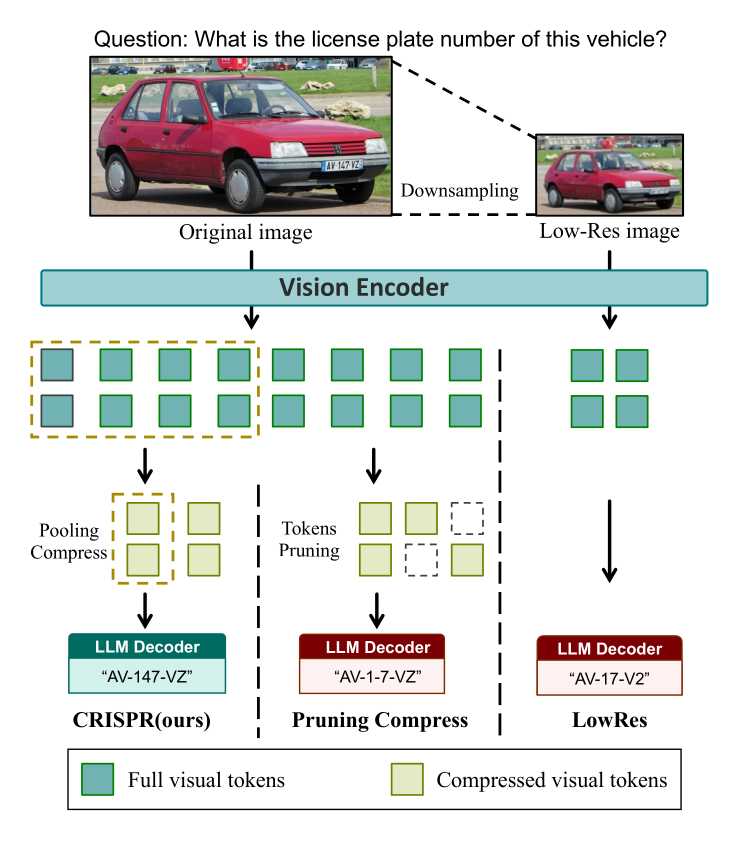

<p align="center">
  <picture>
    <source media="(max-width: 600px) and (prefers-color-scheme: dark)" srcset="assets/banner-mobile-dark.svg">
    <source media="(max-width: 600px)" srcset="assets/banner-mobile-light.svg">
    <source media="(prefers-color-scheme: dark)" srcset="assets/banner-dark.svg">
    <source media="(prefers-color-scheme: light)" srcset="assets/banner-light.svg">
    
  </picture>
</p>

<p align="center">
  <strong>Context-Refined Information Spatial Pooling with Region-awareness<br>for Efficient Visual Token Compression in VLMs</strong>
</p>

<p align="center">
  <a href="#paper-status"></a>
  <a href="#paper-status"></a>
  <a href="https://huggingface.co/Rim2000/CRISPR"></a>
  <a href="LICENSE"></a>
</p>

<p align="center">
  Zuyi Zhou · Dizhan Xue · Shengsheng Qian · Changsheng Xu<br>
  <sub>EverMind AI · Institute of Automation, CAS · UCAS</sub>
</p>

<p align="center">
  <a href="#overview">Overview</a> ·
  <a href="#method">Method</a> ·
  <a href="#quick-start">Quick start</a> ·
  <a href="#checkpoints">Checkpoints</a> ·
  <a href="docs/README.md">Documentation</a> ·
  <a href="#citation">Citation</a>
</p>

<a id="paper-status"></a>

> **Paper & DOI — coming soon.** The DOI is not active yet and is expected to
> become available closer to ACM Multimedia 2026. The paper will also be
> released publicly around that time.

<a id="abstract"></a>

## Overview

**CRISPR compresses visual tokens while retaining their spatial organization.**
It operates on encoded image features, using local aggregation and global
context to produce a shorter sequence for a frozen vision-language model.
This is the official repository for our paper accepted at **ACM Multimedia 2026**.

| Spatial structure | Image-level reuse | Frozen backbone |
|---|---|---|
| Aggregate neighboring tokens and preserve block-center positions. | Compress image features independently of the text prompt. | Place CRISPR between the vision encoder and language decoder. |

## Method

<p align="center">
  <picture>
    <source media="(max-width: 600px) and (prefers-color-scheme: dark)" srcset="assets/method-mobile-dark.svg">
    <source media="(max-width: 600px)" srcset="assets/method-mobile-light.svg">
    <source media="(prefers-color-scheme: dark)" srcset="assets/method-dark.svg">
    <source media="(prefers-color-scheme: light)" srcset="assets/method-light.svg">
    
  </picture>
</p>

1. **Refine.** The Token Refiner (TR) exchanges global context before compression.
2. **Compress.** The Local Token Compressor (LTC) aggregates each spatial block through cross-attention.
3. **Fuse.** Global Token Fusion (GTF) exchanges information among the compressed tokens.

<details>
<summary><strong>View the architecture from the original paper</strong></summary>

<p align="center">
  
</p>

</details>

<details>
<summary><strong>View the visual example from the original paper</strong></summary>

<p align="center">
  
</p>

</details>

## Quick start

Clone the repository, then choose the guide for your backbone:

```bash
git clone https://github.com/ZuyiZhou/CRISPR.git
cd CRISPR
```

**Qwen2.5-VL · Original paper implementation**

```bash
pip install -r requirements.txt
```

[Environment, training, and evaluation →](docs/reproduction.md)

**Qwen3.5 · Fixed-budget visual compressor**

```bash
pip install -r qwen35/requirements.txt
```

[Download and load the compressor →](qwen35/README.md#download-and-load)

Download the matching backbone separately. Each guide explains its model
interface and checkpoint loading requirements.

<a id="code"></a>
<a id="reproduction"></a>

**Working with the original paper?** The [Qwen2.5-VL reproduction guide](docs/reproduction.md)
contains the environment setup, data format, published training commands, and
evaluation examples.

## Checkpoints

All released weights are hosted on **[Hugging Face · Rim2000/CRISPR](https://huggingface.co/Rim2000/CRISPR)**.

| Backbone | Available configurations | Loading guide |
|---|---|---|
| Qwen2.5-VL-3B-Instruct | 9× · 16× compression | [Qwen2.5-VL](docs/reproduction.md) |
| Qwen2.5-VL-7B-Instruct | 16× compression | [Qwen2.5-VL](docs/reproduction.md) |
| Qwen3.5-4B | 16 · 36 · 64 visual tokens per image | [Qwen3.5](qwen35/README.md) |
| Qwen3.5-9B | 36 · 64 visual tokens per image | [Qwen3.5](qwen35/README.md) |

[Browse every checkpoint →](docs/checkpoints.md)

## Repository map

| Path | What you will find |
|---|---|
| [`crispr/`](crispr/) | Original Qwen2.5-VL model and dataset loaders |
| [`qwen35/`](qwen35/) | Qwen3.5 compressor, loading guide, and checkpoint manifest |
| [`scripts/`](scripts/) | Evaluation scripts for CRISPR, original-image, and low-resolution models |
| [`train_crispr_v7.py`](train_crispr_v7.py) | Original Qwen2.5-VL training entry point |
| [`docs/`](docs/) | Documentation index, reproduction guide, and checkpoint directory |
| [`CITATION.cff`](CITATION.cff) | Machine-readable citation |

For questions, start with the [documentation and FAQ](docs/README.md).
Bug reports and contributions are welcome; see [Contributing](CONTRIBUTING.md).

## Citation

If you use CRISPR in your research, please cite our paper:

```bibtex
@inproceedings{zhou2026crispr,
  author    = {Zhou, Zuyi and Xue, Dizhan and Qian, Shengsheng and Xu, Changsheng},
  title     = {CRISPR: Context-Refined Information Spatial Pooling with
               Region-awareness for Efficient Visual Token Compression in VLMs},
  booktitle = {Proceedings of the 34th ACM International Conference on
               Multimedia (MM '26)},
  year      = {2026},
  publisher = {Association for Computing Machinery},
  address   = {New York, NY, USA},
  doi       = {10.1145/3767308.3835007}
}
```

[DOI (activation pending)](https://doi.org/10.1145/3767308.3835007) · [Citation file](CITATION.cff)

## Authors

| Author | Affiliation |
|---|---|
| [Zuyi Zhou](mailto:zuyi.zhou@evermind.ai) | EverMind AI |
| [Dizhan Xue](mailto:dizhan.xue@evermind.ai) | EverMind AI |
| [Shengsheng Qian](mailto:shengsheng.qian@nlpr.ia.ac.cn) · corresponding author | Institute of Automation, CAS · UCAS |
| [Changsheng Xu](mailto:csxu@nlpr.ia.ac.cn) | Institute of Automation, CAS · UCAS |

## License and acknowledgements

CRISPR code is released under the [MIT License](LICENSE). Backbone models and
third-party assets retain their own licenses; see [Third-party notices](NOTICE.md)
for the baseline comparison code. We thank the authors of
[Qwen2.5-VL](https://github.com/QwenLM/Qwen2.5-VL),
[Qwen3.5](https://huggingface.co/Qwen), and the datasets used in the original work.

<details>
<summary>Historical naming</summary>

Some code and comments use the earlier names **CRISP** or **ImageC3**.
They refer to CRISPR and are retained for compatibility.

</details>

<p align="center"><sub><a href="#">Back to top ↑</a></sub></p>
